  
  
  

### Hi, I'm Piyush

I make production lines run faster, scrap less and stay in control.

I'm a mechanical engineer with hands-on experience in manufacturing process optimization, injection molding, quality control and Lean. I work from the shop floor up: root cause analysis, SPC, fixture design in SolidWorks and the data pipelines (MES/SCADA into Power BI) that show where a line is losing time.

- **M.S. in Mechanical Engineering** from Northeastern University, Boston (2026).
- **Previously Manufacturing Engineer at Mylan Laboratories**, where CAPAs from 30+ NCMR investigations delivered **$87K in annual savings** and redesigned fixtures added **80 units/day** across 30+ SKUs.
- **Certified** Lean Green Belt (IISE), SolidWorks Associate (CSWA) and SolidWorks Sustainability Associate.
- **Open to** manufacturing, process, quality and mechanical design engineering roles.

### Selected work

| Project | What it does | Built with |
| --- | --- | --- |
| [**SPC & Capability Studio**](https://github.com/PiyushBhamare2111/spc-capability-studio) | Control charts with Nelson rules, Cp/Cpk/Pp/Ppk and ANOVA Gage R&R. 89 tests check it against Montgomery, NIST and AIAG worked examples. | Python · Streamlit · SciPy |
| [**OEE & Downtime Dashboard**](https://github.com/PiyushBhamare2111/oee-downtime-dashboard) | MES-style plant simulator and dashboard: OEE, Six Big Losses, downtime Pareto, MTBF/MTTR and a what-if panel for changeover reduction. | Python · Streamlit · Plotly |
| [**Surface Defect Inspection**](https://github.com/PiyushBhamare2111/surface-defect-inspection) | ResNet18 classifies 6 steel defect types, with Grad-CAM heatmaps and accept/reject/review thresholds. Stress-tested for focus and lighting drift. | PyTorch · torchvision · Streamlit |
| [**Assembly Line Balancer**](https://github.com/PiyushBhamare2111/assembly-line-balancer) | Takt time, three textbook heuristics and an exact CP-SAT optimizer, with yamazumi charts. Matches the published optimum on all 81 Scholl benchmark instances. | Python · OR-Tools · Streamlit |
| [**Tolerance Stack-up Studio**](https://github.com/PiyushBhamare2111/tolerance-stackup-studio) | Worst-case, RSS and Monte Carlo stack-ups linked to a PFMEA and control plan, with checks that the control plan enforces every Cpk the stack-up assumes. Excel export with live formulas. 54 tests. | Python · Streamlit · openpyxl |
| [**Topology Optimization in Python**](https://github.com/PiyushBhamare2111/topology-optimization-python) | 2D SIMP optimizer written from scratch: FEA, filters and optimality-criteria update, with STL export. Includes a C-clamp case based on my ANSYS project. | NumPy · SciPy · Streamlit |
| [**Predictive Maintenance (RUL)**](https://github.com/PiyushBhamare2111/predictive-maintenance-rul) | Predicts jet-engine remaining life on NASA C-MAPSS and turns each prediction into a cost-optimal maintenance decision. | PyTorch · scikit-learn · Streamlit |
| **Topology-optimized C-clamp** | Topology optimization under a 100 N load cut part volume to 32.6% while keeping peak stress within PLA limits. Printed under 6 g at ±0.2 mm and tested to failure at 0.63 kN, confirming the FEA. | ANSYS · FEA · FFF 3D printing |
| **Robotic arm for automated pickup** | 6-DOF manipulator with inverse kinematics, trajectory planning and vision feedback for automated object pickup. | MATLAB · Computer Vision Toolbox |
| **Conveyor system for gear inspection** | AI-powered conveyor that inspects gears with 90%+ defect detection, with live defect analytics on Power BI dashboards. | Computer vision · MES/SCADA · Power BI |

### Experience

| Role | Company | When |
| --- | --- | --- |
| Manufacturing Engineer, Level 1 | Mylan Laboratories, Nashik | Nov 2022 - Jul 2024 |
| Manufacturing Engineering Intern | Shivkrupa Techno-Plast, Nashik | Jan 2022 - Aug 2022 |
| Manufacturing Engineering Intern | Adamant Engineering, Nashik | Jan 2021 - Aug 2021 |

<b>Highlights by role</b>

**Mylan Laboratories**
- Calibrated Cognex/Keyence machine-vision inspection: accuracy up 15%, 300+ false rejects/month eliminated.
- Integrated MES/SCADA with Power BI across 8 assembly lines for real-time defect tracking.
- Validated inspection systems with Gage R&R and TMV in Minitab; supported IQ/OQ/PQ on 4 production lines.

**Shivkrupa Techno-Plast**
- Tuned process parameters on 11 injection-molding machines (450T-850T) with MATLAB: output up 20%.
- Redesigned trimming fixtures from time studies: cycle time down 7 min/unit.
- Tracked Cp/Cpk across 25+ molds; standardized SOPs that cut rework by 25%.

**Adamant Engineering**
- Stabilized FRP pultrusion with ANSYS FEA and resin curing changes: surface defects down 12%.
- Processed 15+ ECRs in SolidWorks/AutoCAD and supported FMEA covering 10+ failure modes.

### Toolkit

  
  
  
  
  
  

  
  
  
  
  
  
  

  
  
  
  
  

